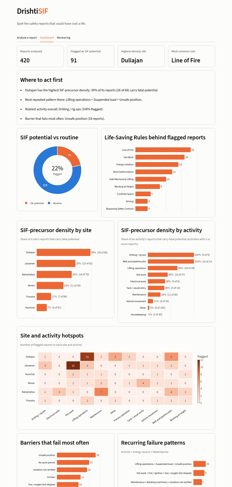

# DrishtiSIF

DrishtiSIF reads free-text safety reports (UA/UC observations, near-misses, incidents) and shows HSE teams which ones could have been fatal, which IOGP Life-Saving Rule they break, and where the same failures keep repeating.

The name comes from *drishti*, Sanskrit for sight.



## What you get for every report

| Output | How it is produced |
| --- | --- |
| SIF potential (%) and band | TF-IDF + logistic regression, trained with class weights so fatal-potential reports are not drowned out |
| IOGP Life-Saving Rule | Keyword scoring over the nine rules, up to three matches, best one shown first |
| Why it is a SIF | Energy source, person exposed, failed barrier, and the phrases the model weighed most |
| Repeating failure pattern | Activity + energy source + failed barrier, counted across all loaded reports |
| Your review | Confirm or reject; decisions are stored and can retrain the model |

The dashboard combines all reports into: SIF vs routine donut, Life-Saving Rule bars, SIF-precursor density by site and by activity, a site-by-activity hotspot grid, most frequent failed barriers, recurring failure patterns, a monthly trend, and a review-first queue you can download.

SIF-precursor density = flagged reports / all reports for a site or activity, so a site that simply reports more does not look riskier.

## Run it

```
pip install -r requirements.txt
streamlit run app.py
```

The model trains on first launch (a few seconds). Run the tests with `pytest`. To regenerate the practice data, run `python -m scripts.make_data`; to print the model check, run `python -m scripts.evaluate`.

## Use your own reports

Choose "Upload my own CSV" in the sidebar. Any file with a free-text column works. If it has `site`, `date` or `report_id` columns they are used; otherwise the site is read from the text.

## Project layout

```
app.py                  Streamlit app: analyse, dashboard, review log
drishtisif/lexicon.py   Word lists for rules, energy sources, barriers, activities, sites
drishtisif/extract.py   Pulls rules, energy, barriers, activity and site out of text
drishtisif/model.py     Training, scoring, key phrases, evaluation
drishtisif/analysis.py  Single-report and batch analysis, density and pattern tables
drishtisif/charts.py    Plotly charts
drishtisif/reviews.py   Saves officer decisions and turns them into training rows
drishtisif/synthetic.py Generator for the practice data
scripts/                make_data.py, evaluate.py
tests/                  Pipeline tests
```

## Read this before you trust the numbers

- **All data here is synthetic.** OIL's real reports are not public, so the training set and the demo reports are generated from templates. Site names are illustrative.
- **The accuracy figures are a sanity check, not evidence.** Scores on held-out synthetic reports are high because the generator and the model share vocabulary. The 16 hand-written reports in `data/handwritten_checks.csv` are too few to prove anything.
- **The real test** is labelling a few hundred genuine OIL reports with HSE officers and measuring recall on the SIF class. The review screen is built to collect those labels.
- The Life-Saving Rule tagger and the barrier and energy extraction are keyword based. They are easy to explain and edit in `lexicon.py`, but they miss unusual wording.
- The SIF threshold in the sidebar trades false alarms against missed fatal-potential reports. Missing a real one costs more, so keep it low.
